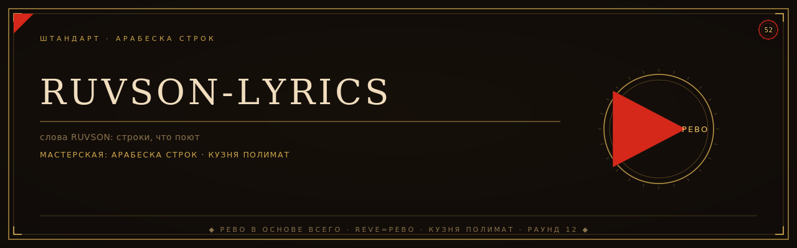

<div align="center">
  
</div>

# RUVSON — тексты 65 треков

Эталон — записи с YouTube-канала @ruvson_music. Субтитры и сайты-транскрипты — только черновик.
Финальная сверка всегда на слух.

## КАРАОКЕ МЕЧТЫ 2.0

Домашнее караоке по текстам RUVSON: `karaoke/index.html` — статическое
приложение без сборки и зависимостей (PWA: ставится и работает офлайн).
Пять слоёв: контентный движок (63 песни ЧИСТОВИК — весь корпус с текстами
(№1–5 — эталон, сверка на слух; №6–65 — чистовик-структура алгоритмом
по команде автора, слова черновиков не тронуты) + минус из файла или
встроенный синт + свои песни через вставку текста), голосовой комфорт
(тест диапазона, разогрев 60 сек, транспонирование ±12 с сохранением
темпа), реальный фидбек (подсветка строк с отсчётом, нотные трубки
эталон-траектории, счёт «Дружелюбный/Судья», «что тренировать» с
переходом к строке), пати (очередь певцов, дуэты по секциям, зал славы,
хайлайты вечера), атмосфера (неон, пад между песнями, большой экран).
Плюс: запись дублей (минус+голос) в IndexedDB с экспортом, гид-вокал
из своего лучшего дубля, детектор тональности файла (Krumhansl-Schmuckler)
со «стартом по голосу». Сингулярное проекта — **«Зелёный коридор»**:
две удачные подряд сами сужают коридор на полутон к оригиналу (одна —
кладёт полшага в копилку, провал её сжигает), а пройденные полутоны
копятся за всё время. Экран **«Профиль вектора»**: кривая роста,
Δv, журнал попыток и «сколько полутонов отвоевано» по каждой песне.
Базовые метки всех 63 песен лежат в `karaoke/lrc/` (генерятся
`scripts/build_lrc.js`, сверяются CI) — приложение поёт сразу,
без тап-синхро.

Карта трендов и источников апгрейда: `docs/RESEARCH_TRENDS_2026.md`.

Запуск (микрофону нужен localhost или https):
```bash
python3 -m http.server 8000
# открыть http://localhost:8000/karaoke/
```
Документация: `docs/KARAOKE_ТЗ.md` (канон, формулы, подсистемы v3.0,
критерии), `docs/KARAOKE_ARCHITECTURE.md` (модули, шифтер, детектор,
запись), `docs/KARAOKE_ROADMAP.md` (этапы 0–5).

## ПРОПАГАТОР ДОМА — корпус числом (engine/)

Одно ядро — все функции структуры графа задач: `K(v) = ν(φ ⊕ Σ ε(K(u)))`
в полукольце (та же математика, что принята организмом commons —
SPEC-0011, волна №32). Живой корпус 65 треков как граф (392 вершины,
584 ребра), посчитанный из факта репо:

```bash
python3 engine/house_graph.py   # компакт-отчёт
python3 engine/tests.py         # пробы: ядро против тупого перебора
```

Ответы числом (2026-11-04): T = 7ч36м; критический путь — все 65 сверок
подряд — **узкое место дома: ухо юзера (7ч26м), технология его не сжимает**;
авто-выравнивание меток (мировая практика whisperX/Enhanced LRC) сжимает
минуты, не часы — его цена качество (трубки word-уровня); слабейшие звенья —
WEAK-субтитры №23, 28, 40, 42, 51, 52, 55, 59, 61; «Зелёный коридор» — образ
того же ядра (CORR, max-plus автомат: за 20 попыток максимум 10 полутонов).
Карта источников: `docs/RESEARCH_ENGINE_2026.md`. Граница: полный крэшинг,
матричный и ячеечный жанры живут в commons taskgraph — дом не дублирует.

## Прототип СЦЕНА v0.1 — доноры СИНГУЛЯРА

`prototip/index.html` — один рабочий прототип на донорах дома СИНГУЛЯР
(lrc-core, wsola-core, opfs-core, канон М9 «каждый узел с тестами»):
реальный минус «Начать сначала» из чистого фонда СИНГУЛЯРА
(htdemucs, убран только вокал), WSOLA-транспонирование ±12
(тон двигается, темп стоит), подсветка строк, YIN-кривая тона,
счёт «Дружелюбный/Судья», Зелёный коридор к оригиналу, дубли в OPFS,
профиль вектора (Δv, отвоёванные полутоны), тап-синхро и экспорт .lrc.
Пробы: 16/16 (node --test пофайлово). Запуск: `python3 -m http.server 8000`
→ `http://localhost:8000/prototip/`.

## КОНВЕЙЕР QUANTUM — монолит с аудио

Монолит `RUVSON_QUANTUM_v5.html` (446.7 МБ) — мой плеер QUANTUM + все
107 треков автора (звук + текст дословно): **103 играют** (68 полных
записей монолита автора + 16 превью 30 с + 19 оживших в v5), 4 молчат —
их звука физически нет ни в одном файле дома: поз. 66 «Поверить так
сложно», 67 «Порой судьба даёт нам шанс», 69 «НЕ ЛЕЧИТЕ МЕНЯ», 81
«Сборник — 2 часа» (мастер 2 ч 20 мин webm/opus ушёл из дома в С137, в
git не коммитился). Тексты всех 107 — дословно из файла автора (каталог
v5 байт-в-байт == v4); аудио-пул монолита автора перенесён дословно.
У монолита автора дубль i=71 (две песни делят ключ) — в QUANTUM чистая
нумерация 1..107, коллизии нет.

19 оживших в v5 (взяты из репо дома): 9 из `singulyar minus/голос/`
(полные записи с голосом, mp3 320k): поз. 32, 35, 37, 38, 39, 40, 41, 47,
80; 9 нарезаны из мастер-сборника «плейлист на 1 час» по паузам оси
Qb8xb0vUYDg (спаны сверены по зачинам и хвостам строк): поз. 51, 52, 53,
59, 61, 62, 63, 64, 65; поз. 82 — полный мастер сборника (7 частей,
4169,7 с) одной записью. Карта — в `download/konveyer/v5_parts/README.md`.

Файл лежит **в самом репо** пятью частями (~89 МБ, лимит git — 100 МБ
на файл): `download/konveyer/v5_parts/` + сборщик с проверкой пломб:

```bash
cd download/konveyer/v5_parts
python3 assemble_v5.py    # соберёт RUVSON_QUANTUM_v5.html и сверит SHA256
```

Пломбы: `SHA256SUMS` (итог sha256 `7cddb666…5b46a4d`).
Тот же файл одним куском — релиз
[quantum-v5](https://github.com/rtynbirf/ruvson-lyrics/releases/tag/quantum-v5):
репо приватное, asset качается только залогиненным браузером или через
API с токеном (`Accept: application/octet-stream`), прямая ссылка без
входа даёт 404. Отчёты, патчеры (собирают сборку байт-в-байт рядом со
своим FULLY_LOADED), md5-карта аудио и инвентаризация: `download/konveyer/`.

## Структура
- `karaoke/` — приложение КАРАОКЕ МЕЧТЫ 2.0 (см. выше; метки — `karaoke/lrc/`)
- `prototip/` — прототип СЦЕНА v0.1 на донорах singulyar (см. выше)
- `download/konveyer/` — конвейер QUANTUM: отчёты v3/v4, патчеры, инвентаризация аудио;
  `v5_parts/` — сам монолит v5 частями + сборщик `assemble_v5.py` (см. выше)
- `lyrics_work/` — черновики по трекам (63 файла, первая строка `META:` — видео, длительность, источник).
  №26 берёт текст из №16 (ремикс), №38 зашит константой в `build_zip.py` — у них своих субтитров нет.
- `scripts/` — пайплайн:
  - `ytget.py / pipeget.py / chanvids.py / build_corpus.py` — снятие субтитров через Piped (прямой YouTube забанен)
  - `get_01.py` — добор №1
  - `apply_corrections.py` — применение слуховых правок пачкой
  - `build_zip.py` — сборка финального архива
  - `build_lrc.js` — генератор/валидатор базовых меток `karaoke/lrc/` (Node)
- `docs/` — ТЗ, архитектура и роадмап караоке
- `download/RUVSON_ВСЕ_ТЕКСТЫ_65.zip` — финальный архив: 65 файлов + `00_ЧИТАЙ_МЕНЯ.txt` + всё одним файлом
- `worklog.md` — журнал работы

## Пересобрать ZIP
```bash
python3 scripts/build_zip.py
```

## Внести правки и залить сюда
Правишь файлы в `lyrics_work/` → пересобираешь ZIP → синк:
```bash
bash scripts/push_github.sh
```

## Соглашения
- `[?]` — место, где черновик заведомо врёт: слушать в первую очередь
- Никаких пометок «не проверено» — либо текст, либо `[?]`
- Каждый аудио-дифф применяется в файлы, ZIP пересобирается, коммит сюда
