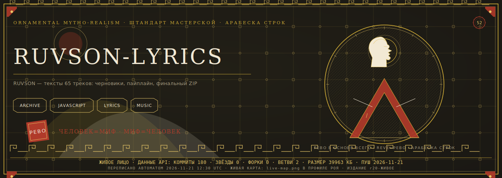
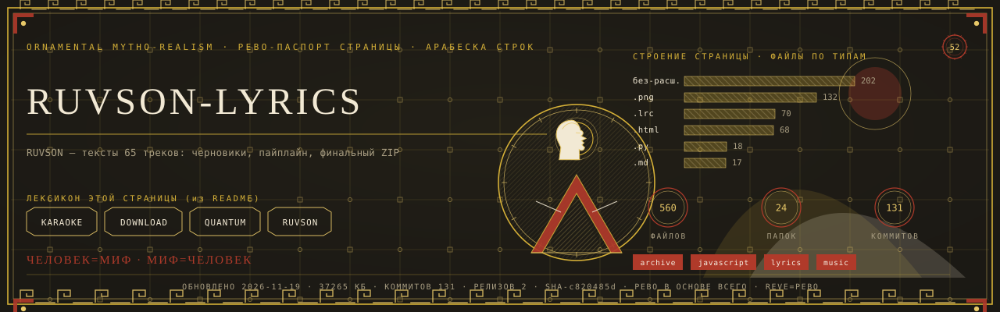

<div align="center">

<a href="https://github.com/rtynbirf/ruvson-lyrics"></a>

</div>

<!--ФОРЖ:МУЗА:НАЧАЛО-->
<div align="center">
  
  <br/>
  
</div>
<!--ФОРЖ:МУЗА:КОНЕЦ-->

<!--ФОРЖ:ПАСПОРТ:НАЧАЛО-->
<div align="center">
  
</div>

| ФАЙЛОВ | ПАПОК | КОММИТОВ | ОБНОВЛЕНО | РЕЛИЗОВ |
|---:|---:|---:|---|---:|
| 648 | 35 | 1 | 2026-11-28 | 2 |
<!--ФОРЖ:ПАСПОРТ:КОНЕЦ-->

<div align="center">
  
</div>

<!--ЕДИНАЯ ФОРМУЛА:НАЧАЛО-->
# ЕДИНАЯ ФОРМУЛА ГЕНЕЗИСА RUVSON

<p align="center"></p>

**ВСЁ СУЩЕЕ — ЕДИНСТВО ВОЗНИКНОВЕНИЯ, ВЗАИМОДЕЙСТВИЯ И ПРЕОБРАЗОВАНИЯ. ОНТОЛОГИЯ СТАНОВЛЕНИЯ — ЕДИНСТВО БЕЗ УНИФИКАЦИИ.**

```
Ξ_{n+1} = Ξ_n ⊔ 𝒯∘𝒲∘𝒱(Ξ_n),   𝒱 ⊥ 𝒲 ⊥ 𝒯,   n = 0, 1, 2, …

Ξ_{n+1} = Ξ_n ⊔ 𝒯( 𝒲( { (c, c′) ∈ T_n : c′ ≇_Σ c } ) )
```

- **Ξ = (C, T, Σ, H)** — состояние генезиса: конфигурации, переходы, язык различений, история.
- **𝒱 — ВОЗНИКНОВЕНИЕ**: переходы, порождающие структурно новое (c′ ≇_Σ c).
- **𝒲 — ВЗАИМОДЕЙСТВИЕ**: связывание возникшего исторически обусловленными отношениями (D_t → T_t → D_{t+1}).
- **𝒯 — ПРЕОБРАЗОВАНИЕ**: обновление условий — переходов, языка (Σ′ ⊇ Σ), полей возможностей.
- **⊔ — ЕДИНСТВО БЕЗ УНИФИКАЦИИ**: монотонное достраивание без слияния; различия не отождествляются.
- **𝒱⊥𝒲⊥𝒯** — триада несводима (доказано v0.5: E⇏ΔD, D⇏E; S2–S4); одна формула — не слияние операторов.
- **Ξ₀ — граничное условие**: формула не претендует на абсолютный генезис (S1–S5: METHODOLOGICALLY_INACCESSIBLE).

Текущий такт **Ξ₁₀→Ξ₁₁**: 31 пара пула → корпусная верификация → **24 ребра E51–E74** внесены, 7 пар остались в поле предсказаний v0.11.
Граф: **68 узлов / 74 ребра**, 53 ARGUMENTED / 21 CANDIDATE, DAG без циклов, изолированных 0.
Проверки: sha256-самоверификация MATCH, **108/108 цитат дословны**, 26/26 тестов PASS.

Межклеточный такт **Ξ₁₁→Ξ₁₂ — СВЕДЕНИЕ НЕСВОДИМОГО**: пять клеток (RUVSON-генетика, OPE-1 RELATION-GENESIS v0.1.3, EMERGENT_CORE v0.3, FACTUM v1.2, SVERNI-канон 190) сведены на триаду 𝒱⊥𝒲⊥𝒯 **без унификации**; 7 пар пула стали RelationCandidate-пакетами v0.1.3 с хэш-линиджем — вердикт верификатора честно **UNKNOWN 7/7** (корпусная связь не притворяется механической новизной, И3 цел). Приклады: OPE-1 **36/36**, FACTUM **28/28** + соты цела, канон 190 гейт **зелёный** + канарейка краснеет, EMERGENT_CORE **15/15** + порог катализа 19/20.

Встречный такт **Ξ₁₂→Ξ₁₃ — ВСТРЕЧНАЯ ВЕРИФИКАЦИЯ МОСТОВ**: 7 UNKNOWN-мостов прогнаны встречным корпусным прогоном — обе стороны каждой пары якорены заново дословно (**36 цитат** с адресами), вердикты честно **ЧАСТИЧНО 7/7**: направление UNDETERMINED 7/7 (роли same/same и same/part, стяжек с консеквентом 0), **3 стяжки-кандидата** зафиксированы как новый материал (НМ-01 песня 6, НМ-02 песня 41, НМ-03 песня 20) — переякорение реестра за v0.12; absence «работа сохранения себя» перепроверена (**0 вхождений**); пакеты OPE-1 и граф v0.11 **не тронуты** (7/7 package_sha256 + meta.sha256 MATCH); 10/10 тестов PASS, антиплагиат 0 пересечений.

Такт **Ξ₁₃→Ξ₁₄ — ПЕРЕЯКОРЕНИЕ И СТЯЖКИ (v0.12) — первый такт по явному критерию останова**: такт живёт, пока даёт хотя бы одно из трёх — (а) улику, (б) опровержение, (в) новую структурную новизну ≇_Σ; на такте выполнены (а)+(в). Реестр пополнен 3 якорями из акта проверки: **I-02#4** (песня 6: «Мы отложить пытаемся на завтра тот миг, / Что ускользает навсегда.» 6:13-14), **I-02#5** (песня 41: «Завтра не будет, есть только сейчас.» 41:10 + «Встреться с этим мгновеньем, / Развернись к нему лицом.» 41:32-33), **VIII-03#3** (песня 20: «А тот, кто ждал и верил по ночам, / Остался тихим, безответным светом.» 20:11-12). Три пары пула v0.11 переведены в **формальные стяжки С-01/02/03** — соположение обеих сторон в одном тексте дословно (дистанции 2/2/3 содержательных строки), консеквентов 0 (скан 12 частиц × 5 окон — 0 вхождений), направление честно **UNDETERMINED 0/3**, направленные рёбра не вносятся — связь без направления не притворяется направленной (единство без унификации); **Σ′ ⊇ Σ**: стяжка — новый объект журнала. Пул **7→4** (ПВ-30/31 оставлены сознательно: кластер G87 покрыт E73/E74). Граф **68 узлов / 74 ребра без изменений**, неизменность: meta.sha256 v0.11 + 7/7 package_sha256 MATCH; **36/36 тестов PASS**, антиплагиат 0, прогресс-лексика 0, воспроизводимость байт-идентична.

Продолжение такта **Ξ₁₃→Ξ₁₄ (v0.12.1) — ОПРОВЕРЖЕНИЕ ЛОЖНОГО (б)**: финальный аудит такта опроверг устаревшую roles-классификацию v0.10 в граф-секции (источники 23 / терминалы 32 / промежуточные 13 переносились без пересчёта с момента v0.11 — отчёт v0.11 считал честно 20/26/22, но поле roles в артефакте не пересчитывалось, и T5 такта v0.12 воспроизвёл устаревшие числа): пересчёт по 74 текущим рёбрам — **источников 20** (вышли I-12, II-11, X-02 через E58/E59/E74), **терминалов 26** (вышли I-01, I-05, II-01, III-03, V-01, VII-03 через E51–E72), **промежуточных 22**, изолированных 0; counts.grounds 45→69 (69+5=74). Граф **не изменён** (68/74), деривационный слой не тронут; T37/T38 защищают от регресса; **38/38 тестов PASS**, независимый верификатор 12/12 PASS. Такт Ξ₁₃→Ξ₁₄ закрыт честно: **(а)+(б)+(в)**.

Артефакты: [`data/RUVSON_geneticheskaya_model_v0.11.json`](data/RUVSON_geneticheskaya_model_v0.11.json) · [`data/REPORT_v0.11.md`](data/REPORT_v0.11.md) · [`data/RUVSON_matematicheskaya_model_v0.10.md`](data/RUVSON_matematicheskaya_model_v0.10.md)
Сведение: [`data/SINTEZ_SVEDENIE_v1.0.json`](data/SINTEZ_SVEDENIE_v1.0.json) (meta.sha256 `6c0f13b3…`) · [`data/REPORT_SINTEZ_v1.0.md`](data/REPORT_SINTEZ_v1.0.md) · [`data/ope1_bridge_v011/`](data/ope1_bridge_v011/) · [`docs/OPE1_RELATION_GENESIS_v0.1.3/`](docs/OPE1_RELATION_GENESIS_v0.1.3/)
Верификация мостов: [`data/RUVSON_verifikacia_v0.11.1.json`](data/RUVSON_verifikacia_v0.11.1.json) (meta.sha256 `a0faaae9…`) · [`data/REPORT_v0.11.1.md`](data/REPORT_v0.11.1.md)
Модель v0.12: [`data/RUVSON_geneticheskaya_model_v0.12.json`](data/RUVSON_geneticheskaya_model_v0.12.json) (meta.sha256 `ce414ff9…`) · [`data/REPORT_v0.12.md`](data/REPORT_v0.12.md)
Модель v0.12.1: [`data/RUVSON_geneticheskaya_model_v0.12.1.json`](data/RUVSON_geneticheskaya_model_v0.12.1.json) (meta.sha256 `79d976fe…`) · [`data/REPORT_v0.12.1.md`](data/REPORT_v0.12.1.md)
<!--ЕДИНАЯ ФОРМУЛА:КОНЕЦ-->


# RUVSON — тексты: фонд 71 (68 чистовиков + 3 транскрипции)

Эталон — записи с YouTube-канала @ruvson_music. Субтитры и сайты-транскрипты — только черновик.
Финальная сверка всегда на слух.

## КАРАОКЕ МЕЧТЫ 2.0

Домашнее караоке по текстам RUVSON: `karaoke/index.html` — статическое
приложение без сборки и зависимостей (PWA: ставится и работает офлайн).
Пять слоёв: контентный движок (68 песен ЧИСТОВИК — весь корпус с текстами,
№1–68, включая №26 и №38; №1–5 — эталон, сверка на слух; №6–65 —
чистовик-структура алгоритмом по команде автора, слова черновиков не тронуты;
№66–68 — LRC-чистовики владельца, 2026-11-22; №69–71 в караоке не входят —
чистовика нет, ASR-транскрипции лежат в download/)
+ минус из файла или
встроенный синт + свои песни через вставку текста), голосовой комфорт
(тест диапазона, разогрев 60 сек, транспонирование ±12 с сохранением
темпа), реальный фидбек (подсветка строк с отсчётом, нотные трубки
эталон-траектории, счёт «Дружелюбный/Судья», «что тренировать» с
переходом к строке), пати (очередь певцов, дуэты по секциям, зал славы,
хайлайты вечера), атмосфера (неон, пад между песнями, большой экран).
Плюс: запись дублей (минус+голос) в IndexedDB с экспортом, гид-вокал
из своего лучшего дубля, детектор тональности файла (Krumhansl-Schmuckler)
со «стартом по голосу». Сингулярное проекта — **«Зелёный коридор»**:
две удачные подряд сами сужают коридор на полутон к оригиналу (одна —
кладёт полшага в копилку, провал её сжигает), а пройденные полутоны
копятся за всё время. Экран **«Профиль вектора»**: кривая роста,
Δv, журнал попыток и «сколько полутонов отвоевано» по каждой песне.
Базовые метки №1–65 лежат в `karaoke/lrc/` (генерятся
`scripts/build_lrc.js`, сверяются CI); №66–68 — unsynced (текст без таймингов,
тайминги не выдумываются) — приложение поёт №1–68 сразу,
без тап-синхро.

Карта трендов и источников апгрейда: `docs/RESEARCH_TRENDS_2026.md`.

Запуск (микрофону нужен localhost или https):
```bash
python3 -m http.server 8000
# открыть http://localhost:8000/karaoke/
```
Документация: `docs/KARAOKE_ТЗ.md` (канон, формулы, подсистемы v3.0,
критерии), `docs/KARAOKE_ARCHITECTURE.md` (модули, шифтер, детектор,
запись), `docs/KARAOKE_ROADMAP.md` (этапы 0–5).

## ПРОПАГАТОР ДОМА — корпус числом (engine/)

Одно ядро — все функции структуры графа задач: `K(v) = ν(φ ⊕ Σ ε(K(u)))`
в полукольце (та же математика, что принята организмом commons —
SPEC-0011, волна №32). Живой корпус 65 треков как граф (392 вершины,
584 ребра), посчитанный из факта репо:

```bash
python3 engine/house_graph.py   # компакт-отчёт
python3 engine/tests.py         # пробы: ядро против тупого перебора
```

Ответы числом (2026-11-04): T = 7ч36м; критический путь — все 65 сверок
подряд — **узкое место дома: ухо юзера (7ч26м), технология его не сжимает**;
авто-выравнивание меток (мировая практика whisperX/Enhanced LRC) сжимает
минуты, не часы — его цена качество (трубки word-уровня); слабейшие звенья —
WEAK-субтитры №23, 28, 40, 42, 51, 52, 55, 59, 61; «Зелёный коридор» — образ
того же ядра (CORR, max-plus автомат: за 20 попыток максимум 10 полутонов).
Карта источников: `docs/RESEARCH_ENGINE_2026.md`. Граница: полный крэшинг,
матричный и ячеечный жанры живут в commons taskgraph — дом не дублирует.

## Прототип СЦЕНА v0.1 — доноры СИНГУЛЯРА

`prototip/index.html` — один рабочий прототип на донорах дома СИНГУЛЯР
(lrc-core, wsola-core, opfs-core, канон М9 «каждый узел с тестами»):
реальный минус «Начать сначала» из чистого фонда СИНГУЛЯРА
(htdemucs, убран только вокал), WSOLA-транспонирование ±12
(тон двигается, темп стоит), подсветка строк, YIN-кривая тона,
счёт «Дружелюбный/Судья», Зелёный коридор к оригиналу, дубли в OPFS,
профиль вектора (Δv, отвоёванные полутоны), тап-синхро и экспорт .lrc.
Пробы: 16/16 (node --test пофайлово). Запуск: `python3 -m http.server 8000`
→ `http://localhost:8000/prototip/`.

## КОНВЕЙЕР QUANTUM — монолит с аудио

Монолит `RUVSON_QUANTUM_v5.html` (446.7 МБ) — мой плеер QUANTUM + все
107 треков автора (звук + текст дословно): **103 играют** (68 полных
записей монолита автора + 16 превью 30 с + 19 оживших в v5), 4 молчат —
их звука физически нет ни в одном файле дома: поз. 66 «Поверить так
сложно», 67 «Порой судьба даёт нам шанс», 69 «НЕ ЛЕЧИТЕ МЕНЯ», 81
«Сборник — 2 часа» (мастер 2 ч 20 мин webm/opus ушёл из дома в С137, в
git не коммитился). Тексты всех 107 — дословно из файла автора (каталог
v5 байт-в-байт == v4); аудио-пул монолита автора перенесён дословно.
У монолита автора дубль i=71 (две песни делят ключ) — в QUANTUM чистая
нумерация 1..107, коллизии нет.

19 оживших в v5 (взяты из репо дома): 9 из `singulyar minus/голос/`
(полные записи с голосом, mp3 320k): поз. 32, 35, 37, 38, 39, 40, 41, 47,
80; 9 нарезаны из мастер-сборника «плейлист на 1 час» по паузам оси
Qb8xb0vUYDg (спаны сверены по зачинам и хвостам строк): поз. 51, 52, 53,
59, 61, 62, 63, 64, 65; поз. 82 — полный мастер сборника (7 частей,
4169,7 с) одной записью. Карта — в `download/konveyer/v5_parts/README.md`.

Файл лежит **в самом репо** пятью частями (~89 МБ, лимит git — 100 МБ
на файл): `download/konveyer/v5_parts/` + сборщик с проверкой пломб:

```bash
cd download/konveyer/v5_parts
python3 assemble_v5.py    # соберёт RUVSON_QUANTUM_v5.html и сверит SHA256
```

Пломбы: `SHA256SUMS` (итог sha256 `7cddb666…5b46a4d`).
Тот же файл одним куском — релиз
[quantum-v5](https://github.com/rtynbirf/ruvson-lyrics/releases/tag/quantum-v5):
репо приватное, asset качается только залогиненным браузером или через
API с токеном (`Accept: application/octet-stream`), прямая ссылка без
входа даёт 404. Отчёты, патчеры (собирают сборку байт-в-байт рядом со
своим FULLY_LOADED), md5-карта аудио и инвентаризация: `download/konveyer/`.

## Структура
- `karaoke/` — приложение КАРАОКЕ МЕЧТЫ 2.0 (см. выше; метки — `karaoke/lrc/`)
- `prototip/` — прототип СЦЕНА v0.1 на донорах singulyar (см. выше)
- `download/konveyer/` — конвейер QUANTUM: отчёты v3/v4, патчеры, инвентаризация аудио;
  `v5_parts/` — сам монолит v5 частями + сборщик `assemble_v5.py` (см. выше)
- `lyrics_work/` — черновики по трекам (63 файла, первая строка `META:` — видео, длительность, источник).
  №26 и №38 — своих субтитров нет; их чистовики живут файлами:
  `download/26_Крик_в_тишине_ЧИСТОВИК.txt` (текст №16) и `download/38_То_о_чём_молчим_ЧИСТОВИК.txt`.
- `scripts/` — пайплайн:
  - `ytget.py / pipeget.py / chanvids.py / build_corpus.py` — снятие субтитров через Piped (прямой YouTube забанен)
  - `get_01.py` — добор №1
  - `apply_corrections.py` — применение слуховых правок пачкой
  - `build_zip.py` — сборка финального архива
  - `build_lrc.js` — генератор/валидатор базовых меток `karaoke/lrc/` (Node)
- `docs/` — ТЗ, архитектура и роадмап караоке
- `download/RUVSON_ВСЕ_ТЕКСТЫ_71.zip` — финальный архив: 68 чистовиков + 3 ASR-транскрипции + `00_ЧИТАЙ_МЕНЯ.txt` + всё одним файлом
- `download/RUVSON_ВСЕ_ТЕКСТЫ_71.txt` + `download/RUVSON_ТЕКСТЫ_71_ПЛОМБЫ.json` — единый фонд 71 одним файлом и пломбы (источник + sha256 каждого текста)
- `worklog.md` — журнал работы

## Пересобрать ZIP
```bash
python3 scripts/build_zip.py
```

## Внести правки и залить сюда
Правишь файлы в `lyrics_work/` → пересобираешь ZIP → синк:
```bash
bash scripts/push_github.sh
```

## Соглашения
- `[?]` — место, где черновик заведомо врёт: слушать в первую очередь
- Никаких пометок «не проверено» — либо текст, либо `[?]`
- Каждый аудио-дифф применяется в файлы, ZIP пересобирается, коммит сюда

<!--ФОРЖ:ПОДВАЛ-->
---

<div align="center">
  <sub>◆ картина и штандарт — ручная ковка <a href="https://github.com/rtynbirf">КУЗНИ ПОЛИМАТ</a> · ЧЕЛОВЕК=АККАУНТ=PID1 ◆</sub>
</div>
